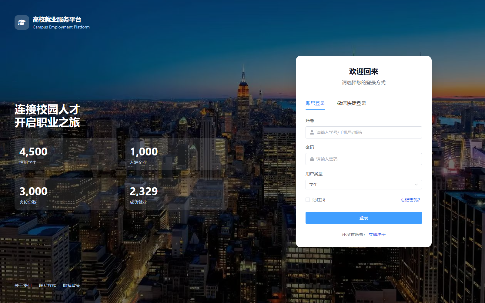
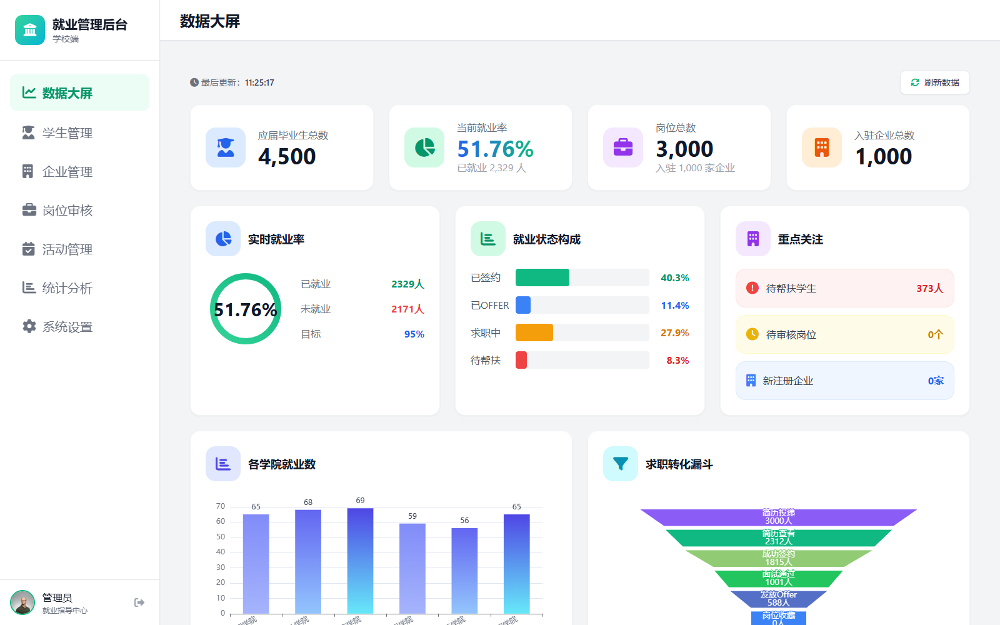
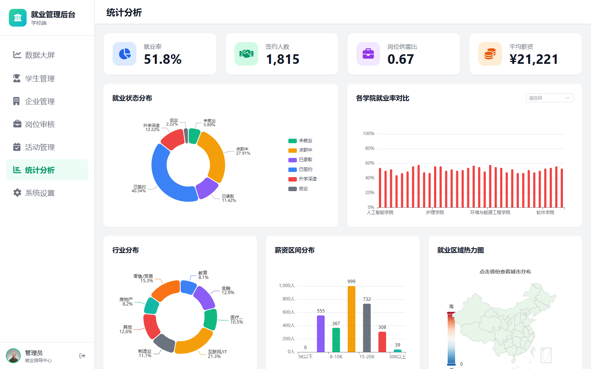
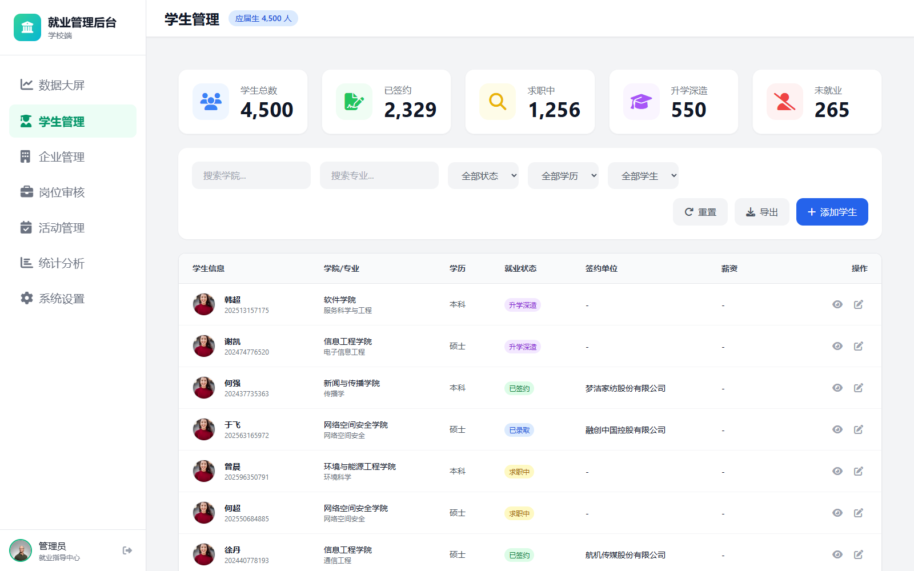
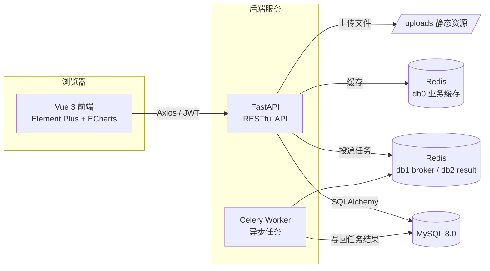

# 高校就业服务平台

面向高校就业场景的前后端分离 Web 平台，围绕 **学生 / 企业 / 管理员** 三类角色，提供岗位发布与检索、简历管理、投递跟踪、宣讲会报名、消息通知以及就业数据可视化分析等能力。

   

---

## 目录

- [功能特性](#功能特性)
- [演示](#演示)
- [技术栈](#技术栈)
- [系统架构](#系统架构)
- [项目结构](#项目结构)
- [快速开始](#快速开始)
- [接口文档](#接口文档)
- [实现亮点](#实现亮点)
- [部署](#部署)

---

## 功能特性

| 角色 | 核心功能 |
| --- | --- |
| 学生端 | 岗位搜索与多维筛选、岗位详情、简历管理与附件上传、一键投递与进度跟踪、岗位收藏、宣讲会报名、消息通知、个人设置 |
| 企业端 | 企业信息维护、岗位发布与上下架、收到的简历筛选、宣讲会管理、招聘数据分析（漏斗 / 转化率） |
| 管理端 | 数据大屏、就业统计分析（就业率 / 学院 / 专业 / 行业 / 薪资 / 地域热力）、学生管理、企业管理与审核、岗位审核、活动管理、系统设置 |

此外还支持辅导员（counselor）角色，用于院系维度的就业数据跟踪。

---

## 演示

### 界面截图

| 登录页 | 管理端数据大屏 |
| --- | --- |
|  |  |

| 数据统计分析 | 学生管理 |
| --- | --- |
|  |  |

### 演示账号

| 角色 | 账号 | 密码 |
| --- | --- | --- |
| 管理员 | `admin02` | `admin123` |

> 学生 / 企业账号由测试数据脚本生成：学生 `student00001` 起、企业 `company00001` 起，默认密码 `password123`。

### 在线体验

本地启动后访问：

- 前端页面：<http://localhost:3000>
- 后端接口文档：<http://localhost:8000/docs>

---

## 技术栈

### 前端

| 类别 | 技术 |
| --- | --- |
| 框架 | Vue 3、Vite 5、Vue Router 4 |
| UI / 样式 | Element Plus、Tailwind CSS、Font Awesome |
| 状态管理 | Pinia |
| 可视化 | ECharts（含中国地图） |
| 工具库 | Axios、Day.js、xlsx、html2canvas、jsPDF、qrcode |

### 后端

| 类别 | 技术 |
| --- | --- |
| 框架 | FastAPI、Uvicorn |
| ORM / 数据库 | SQLAlchemy 2.0、MySQL 8.0（PyMySQL 驱动） |
| 缓存 / 队列 | Redis 7（缓存）、Celery 5（异步任务） |
| 认证 | JWT（python-jose）、Passlib + bcrypt |
| 配置 / 校验 | Pydantic v2、pydantic-settings |
| 定时 / 文档处理 | APScheduler、python-docx、openpyxl |

---

## 系统架构



后端按 `api → services → models/schemas` 分层，接口统一挂载在 `/api/v1`；Redis 的 0 号库用于业务缓存，1、2 号库分别作为 Celery 的 broker 与 result backend。

---

## 项目结构

```text
Graduation_Project/
├── backend/
│   ├── app/
│   │   ├── api/v1/          # 路由：auth、student、company、admin
│   │   ├── core/            # 配置、数据库、JWT、Redis、限流
│   │   ├── models/          # SQLAlchemy 模型
│   │   ├── schemas/         # Pydantic 校验模型
│   │   ├── services/        # 业务逻辑（分析、LLM、辅助函数）
│   │   ├── tasks/           # Celery 异步任务
│   │   ├── uploads/         # 上传文件（运行时不入库）
│   │   ├── celery_app.py
│   │   └── main.py          # 应用入口
│   ├── generate_test_data.py  # 测试数据生成工具
│   ├── requirements.txt
│   ├── Dockerfile
│   └── .env                 # 数据库 / Redis / JWT 等配置
├── frontend/
│   ├── src/
│   │   ├── api/             # Axios 封装与拦截器
│   │   ├── layouts/         # 三类角色布局（含 keep-alive）
│   │   ├── views/           # admin / company / student 页面
│   │   ├── router/          # 路由与权限控制
│   │   ├── stores/          # Pinia 用户状态
│   │   └── styles/          # Tailwind 全局样式
│   ├── public/
│   ├── vite.config.js       # 开发代理 → localhost:8000
│   ├── Dockerfile
│   └── package.json
└── docker-compose.yml       # mysql / redis / backend / celery / frontend
```

---

## 快速开始

### 前置条件

- Python 3.10+
- Node.js 18+
- MySQL 8.0+、Redis 7+（本地开发方式需要自行启动）

### 方式一：Docker 一键启动

```bash
# 1. 准备环境变量（仓库中的 .env 已按避让端口配置好）
cp .env.docker .env

# 2. 构建并启动 5 个服务
docker compose up -d --build

# 3. 查看状态
docker compose ps
```

启动完成后：

| 服务 | 地址（按 `.env.docker` 默认端口） |
| --- | --- |
| 前端（Nginx） | <http://localhost:8080> |
| 后端 API 文档 | <http://localhost:18000/docs> |
| MySQL | `localhost:13306` |
| Redis | `localhost:16379` |

如需使用默认端口（8000 / 3306 / 6379），修改 `.env` 中的 `BACKEND_PORT`、`MYSQL_PORT`、`REDIS_PORT` 即可。

MySQL 首次启动会自动执行 `docs/database_schema.sql` 与 `docs/add_indexes.sql` 完成建表与索引初始化。

### 方式二：本地开发

**1. 初始化数据库**

```bash
mysql -u root -p
CREATE DATABASE campus_employment CHARACTER SET utf8mb4 COLLATE utf8mb4_unicode_ci;
```

依次导入 `docs/database_schema.sql`、`docs/add_indexes.sql`。

**2. 启动后端**

```bash
cd backend
python -m venv .venv
# Windows: .venv\Scripts\activate    macOS/Linux: source .venv/bin/activate
pip install -r requirements.txt
uvicorn app.main:app --reload --host 127.0.0.1 --port 8000
```

`backend/.env` 示例配置：

```ini
DATABASE_URL=mysql+pymysql://root:密码@localhost:3306/campus_employment
REDIS_URL=redis://localhost:6379/0
CELERY_BROKER_URL=redis://localhost:6379/1
CELERY_RESULT_BACKEND=redis://localhost:6379/2
SECRET_KEY=生产环境请替换为随机字符串
```

**3. 启动 Celery Worker（可选，用于异步导出与通知）**

```bash
cd backend
celery -A app.celery_app worker --loglevel=info --concurrency=2
```

**4. 启动前端**

```bash
cd frontend
npm install
npm run dev
```

前端默认运行在 <http://localhost:3000>，`vite.config.js` 已将 `/api`、`/uploads` 代理到 `http://localhost:8000`。

### 生成演示数据

```bash
cd backend
python generate_test_data.py
```

按提示输入各数据规模（直接回车使用默认值），可生成学生、企业、岗位、简历、投递、宣讲会等数据，便于查看数据大屏与统计图表。

---

## 接口文档

服务启动后直接访问：

| 文档 | 地址 |
| --- | --- |
| Swagger UI | <http://localhost:8000/docs> |
| ReDoc | <http://localhost:8000/redoc> |

接口统一前缀 `/api/v1`，采用 JWT Bearer 认证，主要模块：

```text
/auth                  登录、注册、当前用户、短信 / 微信登录
/student/jobs          岗位搜索与详情
/student/resumes       简历管理
/student/applications  投递与进度
/student/career-talks  宣讲会
/company/jobs          岗位管理
/company/resumes       简历筛选
/company/analytics     招聘数据分析
/admin/statistics      就业统计与数据大屏
/admin/students        学生管理
/admin/companies       企业管理
/admin/jobs            岗位审核
/admin/activities      活动管理
/admin/system          系统设置
```

---

## 实现亮点

| 方向 | 实现说明 |
| --- | --- |
| 统计性能 | 统计接口使用 `JOIN` + `GROUP BY` 聚合，避免 N+1 查询；管理端大屏改为单接口聚合返回，替代多次独立请求 |
| Redis 缓存 | 统计结果缓存 10 分钟、岗位列表缓存 5 分钟，缓存键由排序后的查询参数哈希生成，避免重复计算 |
| 接口限流 | 登录 / 注册等敏感接口基于 Redis `INCR + EXPIRE` 管道实现原子计数限流（登录 10 次/分钟、注册 5 次/分钟） |
| 异步任务 | Celery 处理数据导出、消息通知等耗时任务，Redis db1 作为 broker、db2 作为结果后端 |
| 前端体验 | 布局层使用 `<keep-alive>` 缓存页面、看板数据加载做 30 秒防抖、列表接口并行请求，减少白屏与重复渲染 |
| 数据可视化 | ECharts 实现就业状态环图、学院就业率、行业分布、薪资区间、地域热力图与求职转化漏斗 |

---

## 部署

推荐使用仓库根目录的 `docker-compose.yml`，一条命令拉起 MySQL、Redis、FastAPI、Celery Worker 与 Nginx 前端：

```bash
cp .env.docker .env
docker compose up -d --build
```

生产环境注意：

- 修改 `SECRET_KEY` 为随机字符串
- 关闭或限制 CORS 白名单（当前为允许所有来源，便于本地联调）
- 为 MySQL、Redis 配置持久化与访问密码
- 前端使用 Nginx 托管 `dist`，并将 `/api`、`/uploads` 反向代理到后端

---

> 本项目为毕业设计作品，仅用于学习与技术交流。
</content>
